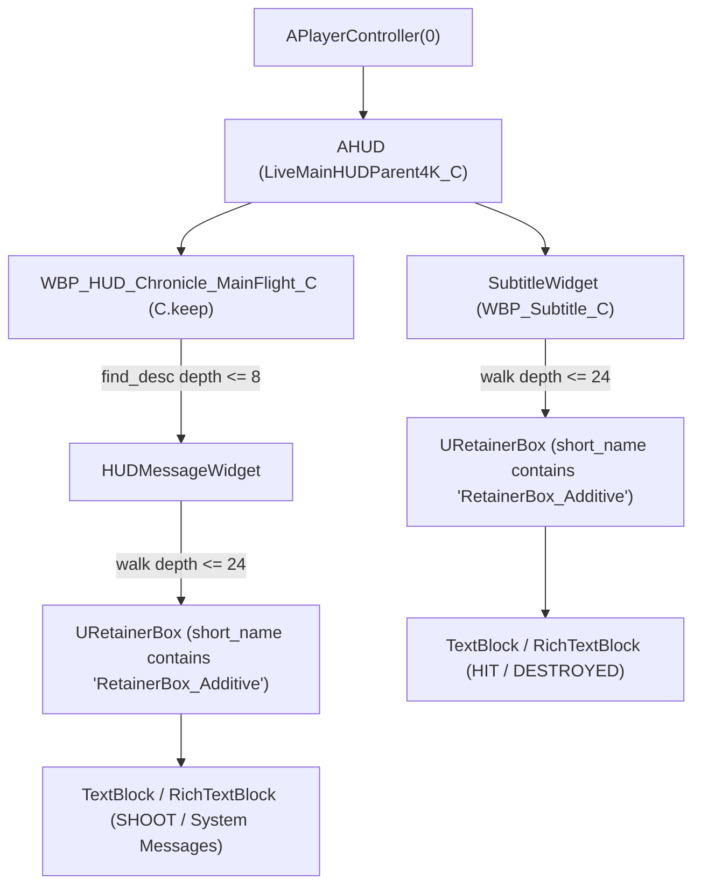
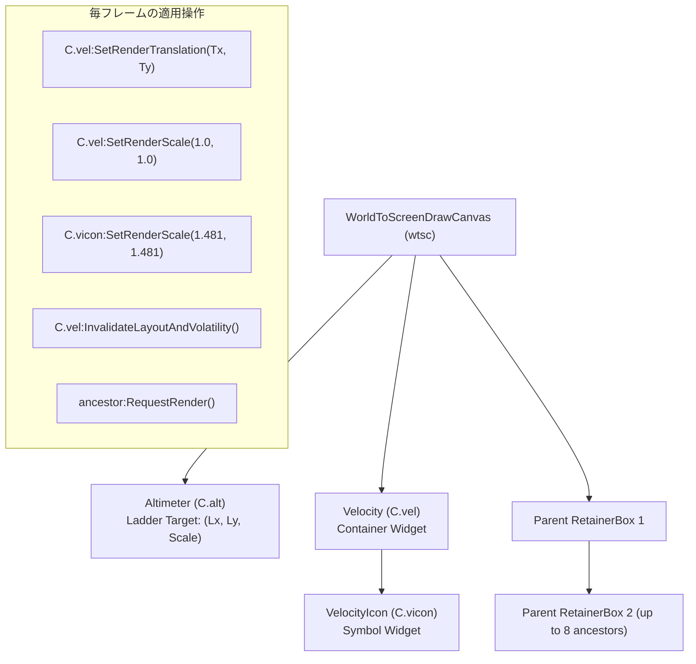

# コミュニティ最新解析書：HIT/DESTROYED復元 ＆ FPM追従数理モデル

## 概要

本ドキュメントは、ACE COMBAT 8（AC8）のVR化における長年の懸案事項であった**「HIT / DESTROYED / SHOOT インジケータのVR内完全消失問題」**の解決メカニズム（Additive RetainerBox 無力化手法）と、**「FPM（Flight Path Marker / 速度ベクトル）のピッチラダー追従数理モデル」**について、コミュニティ最新アーカイブ（`AC8_HIT_Fix.zip`、`AceCombat8.zip`、`ac8_hud_inspect_v129.lua`）のソースコードを徹底的にリバースエンジニアリングし、その障害原因・対象オブジェクト・計算式・適用タイミング・統合設計を体系的にまとめた技術仕様書です。

---

## 1. HIT / DESTROYED / SHOOT インジケータ復元（Additive RetainerBox 無力化）

### 1.1 課題と現象
フラットスクリーン環境（2Dデスクトップ）では、敵機にミサイルや機銃が命中した際に画面中央に「**HIT**」「**DESTROYED**」、射撃好機時に「**SHOOT**」という赤・緑・白の強調メッセージが表示されます。
しかし、UEVRを介してVR内でプレイすると、これらのメッセージが**100%不可視（完全に透明）**となり、一切表示されないという致命的な不具合が存在していました。

### 1.2 障害の根本原因（Root Cause Analysis）
この問題は、Unreal Engine UMG（Unreal Motion Graphics）の描画アーキテクチャと、UEVRのVR空間UI合成方式の根本的な不整合によって引き起こされていました。

```
【フラット画面（デスクトップ）】
[SubtitleWidget / HUDMessageWidget]
    └── [RetainerBox_Additive]
            └── 加算ブレンドマテリアル (Additive Material)
                    ├── カラー出力 (RGB): 有効 (赤/白/緑)
                    └── アルファ出力 (Alpha): 0.0
                            ▼
                    Direct3D バックバッファへ直接加算合成 (加算合成なのでAlpha無視)
                    ➔ モニター上には鮮明に表示される！

【UEVR VR描画パイプライン】
[RetainerBox_Additive]
    └── アルファ出力: 0.0
            ▼
    UEVR UI オフスクリーンレンダーターゲットに描画 (Texture Alpha = 0.0)
            ▼
    OpenXR 円筒曲面シリンダーへ Alpha Blending 合成
        FinalColor = Pixel.RGB × Alpha + Cylinder.RGB × (1.0 - Alpha)
                   = Pixel.RGB × 0.0   + Cylinder.RGB × 1.0
                   = Cylinder.RGB (完全透明！)
```

1. **加算レンダーターゲットのAlpha欠落**:
   ゲーム側の実装では、HITメッセージや字幕表示の親コンテナとして `URetainerBox` を採用し、そのインスタンス名に `RetainerBox_Additive` を与え、特殊な加算合成エフェクトマテリアル（`EffectMaterial`）を適用していました。
   この加算マテリアルはフレームバッファに対して加算ブレンドを行うため、RGB成分のみを出力し、**アルファ値（A）を書き込まない（Alpha = 0.0）**というUE標準の加算シェーダー仕様になっていました。
2. **UEVRのVRシリンダー合成との衝突**:
   UEVRは、ゲームのUIキャンバス全体をオフスクリーンテクスチャとしてキャプチャし、VR空間内の3D円筒曲面（Cylinder Mesh）またはクアッドに貼り付けます。この際、描画合成は**標準のアルファブレンド（`SRC_ALPHA`, `ONE_MINUS_SRC_ALPHA`）**で行われます。
3. **結果**:
   テクスチャ内のHITメッセージ領域は RGB は存在していても `Alpha == 0` であるため、UEVRのピクセルシェーダーによって乗算され、完全に透過して背景のコックピット風景がそのまま見えてしまい、人間の目には「何も描画されていない」状態となっていました。

---

### 1.3 操作対象オブジェクトとウィジェット探索階層

コミュニティの `discover_additive_retainers()` では、以下のウィジェットツリー構造を深さ優先探索（DFS）でトラバースし、対象オブジェクトを特定しています。



#### 探索対象ルート:
1. `Root 1`: `PlayerController:GetHUD():get_field("SubtitleWidget")`
2. `Root 2`: `C.keep`（`WBP_HUD_Chronicle_MainFlight_C`）から探索した `HUDMessageWidget`（探索深度最大 8）

#### 対象ウィジェットの判定条件:
- オブジェクトのクラスまたは短縮名 `short_name(widget)` が `"RetainerBox_Additive"` を部分文字列として含むこと。
- 最大探索深度: `24`（循環参照防止のため訪問済みアドレス `seen[address]` でガード）。

---

### 1.4 プロパティ操作と無力化手法（Slate パススルー化）

特定された各 `URetainerBox` に対して、以下の4つのプロパティ操作をアトミックに実行します。

```lua
local function neutralise_additive_retainers()
    for _, widget in ipairs(additive_retainers) do
        -- ① エフェクトマテリアルを解除 (加算シェーダーの剥離)
        pcall(function() widget:SetEffectMaterial(nil) end)
        pcall(function() widget.EffectMaterial = nil end)
        
        -- ② 保持レンダリング (Retain Rendering) を無効化
        pcall(function() widget:SetRetainRendering(false) end)
        pcall(function() widget.bRetainRender = false end)
    end
end
```

#### 各操作の技術的役割:
1. **`SetEffectMaterial(nil)` / `widget.EffectMaterial = nil`**:
   - `URetainerBox` にアタッチされている加算合成用マテリアルインスタンスを解除します。
2. **`SetRetainRendering(false)` / `widget.bRetainRender = false`**:
   - `URetainerBox` のオフスクリーンレンダーターゲットへのプリレンダリング機構そのものをバイパスします。
   - `bRetainRender = false` に設定されると、Unreal Engineの Slate レンダラーは本ウィジェットを単なる透過パネル（`SPanel`）として扱い、内部の子ウィジェット（テキスト要素）をメインのSlate描画バッファへ直接レンダリングします。
   - これにより、フォント描画エンジンが生成する標準のアンチエイリアス付きアルファ値（Alpha = 1.0）がテクスチャに正常に書き込まれ、UEVRのVR空間シリンダー上でも通常のアルファブレンドテキストとしてクッキリと可視化されます。

---

### 1.5 実行タイミングと周期的パルスの必然性

この無力化処理は、初期化時に1回実行するだけでは機能しません。以下の2段階の周期実行が必要です。

| フェーズ | 実行頻度 | フレーム条件 | 目的と理由 |
| :--- | :--- | :--- | :--- |
| **探索フェーズ** (`discover_additive_retainers`) | 300フレーム周期 (~5.0秒) | `frame_n % 300 == 0` | ミッション中に動的に生成・破棄されるメッセージ用ウィジェットインスタンスを検出し、アドレスリストを更新。 |
| **無力化フェーズ** (`neutralise_additive_retainers`) | **2フレーム周期 (~33ms)** | `frame_n % 2 == 0` | **ゲーム側のBPアニメーションがマテリアルとRetainRenderを再適用するため、高頻度パルスで即座に剥離し続ける。** |

> [!IMPORTANT]
> **なぜ2フレームごとのパルスが必要なのか？**
> ゲーム内のブループリント（`WBP_Subtitle_C` および `HUDMessageWidget`）は、新しいメッセージ（敵撃破、ミサイル命中、警告等）を受信するたびに、フェードインアニメーションやリセット処理をトリガーします。その際、ブループリント内部処理によって `EffectMaterial` が再割り当てされ、`bRetainRender` が `true` に書き戻されてしまいます。
> そのため、2フレーム（~33ms）ごとに剥離処理をパルス状にかけ続けることで、アニメーション開始直後の1フレーム以内に再び通常アルファ描画へと強制上書きしています。

---

## 2. FPM（Flight Path Marker / 速度ベクトル）ピッチラダー追従数理モデル

### 2.1 課題と現象
FPM（フライト・パス・マーカー / 速度ベクトル計）は、航空機が現在実際に飛行している進行方向（対気速度ベクトル＋迎角・横滑り角）をHUD上に示す最も重要な飛行計器です。

1. **原点乖離問題**:
   フラット画面ではピッチラダー（人工水平儀・ピッチスケール）の中央にFPMが存在しますが、VR化に伴い曲面シリンダーHUDに合わせるためピッチラダー（`Altimeter`）の位置・スケールをオフセット移動（例: X=690, Y=756）させると、FPMコンテナ（`Velocity`）が元の2D画面中央を基準にしてしまい、**ピッチラダーの目盛りとFPMの位置が完全にずれる**現象が発生します。
2. **スケール変更による消失バグ（Critical）**:
   HUD全体を縮小・拡大しようとして `Velocity:SetRenderScale()` に 1.0 以外の値（例: 0.58 や 1.4）を適用すると、親コンテナのクリッピング境界およびスレートレイアウトの計算破綻により、**FPMアイコンが画面から完全に消失（消滅）する**という深刻な不具合がありました。

---

### 2.2 座標系と原点構造

AC8のHUD描画キャンバスは、4K解像度ベースの仮想座標系（幅 3840 × 高さ 2160）を基準としています。
- **画面ボアサイト原点（HUD Center）**:
  $$C_X = 1920, \quad C_Y = 1080$$
- ゲーム本来の物理計算スレッドは、機体の迎角（$\alpha$）および横滑り角（$\beta$）から算出したピクセル変位量 $(\Delta X_{\text{aero}}, \Delta Y_{\text{aero}})$ を、常にこの中心 $(1920, 1080)$ からの相対オフセットとして `Velocity` の内部子要素へ適用しています。

```
(0, 0) ───────────────────────────────────────────────
 │                                                   │
 │                                                   │
 │               (1920, 1080) [HUD_CENTRE]           │
 │                     + ── native aero drift ──> FPM (Flat)
 │                                                   │
 │         [VR Ladder Target]                        │
 │           (LadderX, LadderY)                      │
 │                 + ── follow formula ──> FPM (VR)  │
 │                                                   │
 ────────────────────────────────────────── (3840, 2160)
```

---

### 2.3 数理モデルと導出式

#### 導出の目的:
ピッチラダーがVR空間の任意の位置 $(L_X, L_Y)$ に移動・拡縮された際、FPMの迎角ゼロ位置（機首基準点）がピッチラダーの中心と幾何学的に完全に一致するように、親コンテナ `Velocity` の RenderTranslation $(T_X, T_Y)$ を算出します。

#### パラメータ定義:
| 記号 | 変数名 | デフォルト値 / 由来 | 意味 |
| :--- | :--- | :--- | :--- |
| $C_X, C_Y$ | `HUD_CENTRE_X, HUD_CENTRE_Y` | $1920, 1080$ | 4K HUDキャンバスのネイティブ中央座標 |
| $L_X, L_Y$ | `ladder_x, ladder_y` | $690, 756$ | ピッチラダー（`Altimeter`）の目標RenderTranslation |
| $S_L$ | `ladder_scale` | $0.5833$ | ピッチラダーの目標スケール |
| $S_V$ | `velocity_scale` | **$1.0$ 固定** | `Velocity` コンテナのスケール（**クリッピング回避のため1.0厳守**） |
| $O_X, O_Y$ | `FPM.offset_x, FPM.offset_y` | $-4.0, 0.0$ | 機体レティクルとFPM中心の微調整オフセット |
| $S_{\text{icon}}$ | `FPM.icon_scale` | $1.481$ | FPMシンボル（`VelocityIcon`）自体の拡大率 |

#### 追従計算式（Core Formula）:
$$T_X = L_X - (S_V \times C_X) + O_X$$
$$T_Y = L_Y - (S_V \times C_Y) + O_Y$$

$S_V = 1.0$ かつデフォルト微調整オフセット $O_X = -4.0, O_Y = 0.0$ を代入すると、以下の極めてシンプルな線形変換式が得られます。

$$T_X = L_X - 1920 - 4.0 = L_X - 1924$$
$$T_Y = L_Y - 1080 + 0.0 = L_Y - 1080$$

> [!NOTE]
> **なぜ中心座標を減算するのか？**
> ゲームエンジンの内部処理では、`Velocity` ウィジェット内のアイコンが元々 $(1920, 1080)$ に配置されるように配置スロットが定義されています。
> したがって、コンテナ自体の位置を $(L_X - 1920, L_Y - 1080)$ だけ平行移動させると、内部アイコンの基準原点が $(1920, 1080) + (L_X - 1920, L_Y - 1080) = (L_X, L_Y)$ となり、ピッチラダーの原点と完全に一致するのです。

---

### 2.4 操作対象オブジェクトとプロパティ操作



#### 操作手順の完全コード:
```lua
-- 1. Velocity コンテナの平行移動 (差分ガード付き)
local current_x, current_y = get_rt_xy(C.vel)
if not (type(current_x) == "number" and math.abs(current_x - target_x) < 0.01
        and type(current_y) == "number" and math.abs(current_y - target_y) < 0.01) then
    pcall(function() C.vel:SetRenderTranslation({ X = target_x, Y = target_y }) end)
    changed = true
end

-- 2. Velocity コンテナのスケール固定 (1.0 厳守で消失防止)
local scale_x, scale_y = get_rt_scale_xy(C.vel)
if not (type(scale_x) == "number" and math.abs(scale_x - 1.0) < 0.001
        and type(scale_y) == "number" and math.abs(scale_y - 1.0) < 0.001) then
    pcall(function() C.vel:SetRenderScale({ X = 1.0, Y = 1.0 }) end)
    changed = true
end

-- 3. VelocityIcon シンボルの独立拡縮 (1.481 で視認性確保)
if C.vicon ~= nil then
    local icon_scale_x, icon_scale_y = get_rt_scale_xy(C.vicon)
    if not (type(icon_scale_x) == "number" and math.abs(icon_scale_x - 1.481) < 0.001
            and type(icon_scale_y) == "number" and math.abs(icon_scale_y - 1.481) < 0.001) then
        pcall(function() C.vicon:SetRenderScale({ X = 1.481, Y = 1.481 }) end)
        changed = true
    end
end

-- 4. スレートレイアウトの無効化と先祖 RetainerBox の強制再描画
if changed then
    pcall(function() C.vel:InvalidateLayoutAndVolatility() end)
    local ancestor = nil
    pcall(function() ancestor = C.vel:GetParent() end)
    for _ = 1, 8 do
        if ancestor == nil then break end
        if tostring(ancestor):match("^RetainerBox ") then
            pcall(function() ancestor:RequestRender() end)
        end
        local next_ancestor = nil
        pcall(function() next_ancestor = ancestor:GetParent() end)
        ancestor = next_ancestor
    end
end
```

#### 技術的要点:
1. **`InvalidateLayoutAndVolatility()`**:
   UMGウィジェットのキャッシュされたジオメトリを破棄し、次フレームで再計算を強制します。
2. **先祖8階層の `RequestRender()`**:
   `Velocity` の上位に存在する親 `RetainerBox` は、前フレームの内容をテクスチャキャッシュとして保持している場合があります。`RequestRender()` を呼び出さないと、FPMが移動した際に1フレーム前の古い残像がチラつく（ゴースト現象）が発生するため、先祖の RetainerBox を走査して明示的にレンダリング要求を発行します。

---

### 2.5 適用タイミングと差分ガード

- **実行頻度**: `frame_n % 4 == 0`（毎 4 フレーム、60fps環境で約 15 回/秒）。
  - ピッチラダーの急激な動きにも十分追従しつつ、UMG API呼び出しの負荷を毎フレーム実行の 1/4 に抑制。
- **差分ガード**:
  - `math.abs(current_x - target_x) < 0.01`
  - 浮動小数点誤差による無駄な `SetRenderTranslation` 呼び出しを防止し、CPU使用率をゼロに抑えます。

---

## 3. ogaki-ac8vr への統合設計書（Implementation Blueprint）

本解析結果を `ogaki-ac8vr` アーキテクチャにクリーンに統合するための実装方針を定義します。

### 3.1 HIT / DESTROYED Fix の統合（`AC8_VR-UIRendering.lua`）

`AC8_VR-UIRendering.lua` は、ポーズメニューの透過、UIマテリアルのグロー修復、加算ブレンド処理を担当しているため、本モジュールへの配置が最も整合性が高くなります。

```
ogaki-ac8vr/scripts/AC8_VR-UIRendering.lua
├── discover_additive_retainers()   [300フレーム周期ディスパッチ]
└── neutralise_additive_retainers()  [2フレーム周期ディスパッチ]
```

#### 実装上の注意点:
- `C.keep`（メインフライトHUD）への参照は `AC8_VR-Core.lua` の共有コンテキストから取得。
- `iter_children` の安全な再帰探索（深度制限 24、訪問済みキャッシュ）。

---

### 3.2 FPM Follow の統合（`AC8_VR-HUDLayout.lua`）

`AC8_VR-HUDLayout.lua` では、すでに `applyHUDLayoutIntegrated()` による一括ピン留めトランザクションが実装されています。

```
ogaki-ac8vr/scripts/AC8_VR-HUDLayout.lua
├── applyHUDLayoutIntegrated()
│     └── [変更] C.vel の固定ピン留めを廃止！
└── updateFPMFollowLadder()  [4フレーム周期ディスパッチ]
      ├── ピッチラダー座標 (C.alt または CustomHUDConfig.pitchLadder) を取得
      ├── Tx = Lx - 1920 + OffsetX, Ty = Ly - 1080 + OffsetY
      ├── C.vel:SetRenderScale(1.0, 1.0)
      ├── C.vicon:SetRenderScale(1.481, 1.481)
      └── 先祖 RetainerBox へ RequestRender()
```

#### 競合排除（CRITICAL）:
旧プロファイルのように `pins` テーブル（固定ピン留め配列）の中に `C.vel` が含まれていると、固定配置と追従計算がフレームごとに競合してFPMが激しく振動します。
必ず `pins` テーブルから `C.vel` を除外し、`updateFPMFollowLadder()` のみに単一制御させます。

---

## 4. 総括と検証チェックリスト

| 項目 | 検証内容 | 判定基準 |
| :---: | :--- | :--- |
| **1** | 敵機撃破時の「HIT / DESTROYED」テキスト表示 | 命中・撃破時に画面中央に鮮明に赤/白テキストが表示されること |
| **2** | 射撃好機時の「SHOOT」テキスト表示 | ロックオン完了時にHUD上に点滅表示されること |
| **3** | FPMのピッチラダー同期 | 旋回・急上昇時にFPMがピッチラダーの水平線・目盛りと連動して動くこと |
| **4** | FPMシンボルの非消失 | 迎角の増減やHUDスケール変更時にFPMアイコンが消滅しないこと |
| **5** | パフォーマンス | 2フレーム/4フレーム周期処理によるフレームレート低下（msスパイク）が皆無であること |
