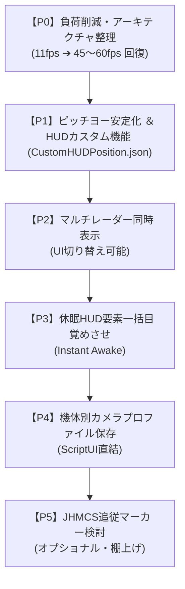

# ogaki-ac8vr 総合タスクリスト ＆ リファクタリング計画書

ユーザー様からのご指示・コメントおよび最新のソースコード解析（C++ DLL 含む）を反映した、**「インクリメンタル検証・リファクタリング計画書（兼タスクリスト）」** です。

---

## 🎯 現在の到達点とベースライン状態

- **現在のGitブランチ**: `baseline-clean`
- **コミット位置**: `ef06afb` (Update feature description for Lua data file offsets - 本家 `upstream/main` の起点)
- **環境状態**: 余計な変更・中途半端な修正をすべて取り除き、**一番最初のフォーク元（クリーンなベースライン）** に完全巻き戻し完了。
- **ゲーム環境への反映**: `sync-to-game.ps1` により、`%APPDATA%\UnrealVRMod\AceCombat8` へ初期状態を完全同期済み。

---

## 🔍 ソースコード解析から判明した最重要知見（設計指針）

1. **C++ DLL (`AC8_VR-Runtime.dll`) の責務**:
   - 後段の **DirectX 12 / OpenXR 合成処理**（UIテクスチャを 2560x1338 で受け取り、グロー発光を付与して VR空間の円筒曲面スクリーン Cylinder Layer に投影）。
   - ピッチラダーの座標や透過度を直接書き換えたり、消去したりはしていない。
   - ⚠️ **Lua からの 250ms ハートビート（`AC8_HUD_PolicyV50` パケット）の継続送信が必須**。

2. **ピッチ・ヨー（人工水平儀）の挙動計算の担当区分**:
   - **ゲーム本体（UE5 / AC8ブループリント）**:
     飛行物理に伴うピッチ角・ロール角の計算、目盛り（Mark0〜6）の上下アニメーション移動、機体の傾きに応じた回転、プラス/マイナス目盛りの動的切り替え。
     👉 **挙動のアニメーション計算はゲーム本体が完璧に行っているため、スクリプト側で再計算してはならない。**
   - **Lua スクリプト（MOD側）**:
     VRコックピット正面への基準位置オフセット（`x=690, y=818`）、VR適正スケール（`sc=0.519`）、子パーツ全透過度カスケード（`op=1.0`）、および描画直前（Slateフック）での固定。

3. **これまでの不具合（11fps激減・点滅・消失）の真因**:
   - **激重（11fps）**: `AC8_VR-UIRendering.lua` や `AC8_VR-HUDLayout.lua` が毎秒・毎フレーム 3,809〜4,000個の UMG ウィジェット全探索（`get_objects_matching`）を繰り返し、先祖32階層の Slate ジオメトリ計算でレンダラースレッドを占有していた。
   - **点滅・ジッター（ちらつき）**: `AC8_VR-HUDLayout.lua` の 4フレーム間引き書き込み（`ticks % 4 ~= 0`）と `InheritedHUD.lua` で同じウィジェットに対して別座標を奪い合っていた。
   - **消失・うっすら**: 親だけ不透明にしても、ゲーム本来のデフォルトで子パーツ（`Positive_R`, `Negative_R`, `End0_R_1` 等）が `0.550`（薄い半透明）にリセットされていたため、旧安定版にあった**子パーツ透過度カスケード（`apply_node_opacity`）** と **ウイスキーマークピン留め（`WhiskyMarkPanel`）** の復活が必要。

---

## 📌 優先順位別タスク一覧

---

### 🔴 【P0】負荷削減 ＆ アーキテクチャ・リファクタリング（最優先）

- [ ] **1. 全ウィジェット走査（`get_objects_matching`）のキャッシュ化**
  - 出撃時の1回（またはHUDエポック切り替え時のみ）走査し、定常フレームでの4,000個全探索を完全撤廃。
  - C++ への `AC8_HUD_PolicyV50` パケット送信（250ms ハートビート）は軽量に毎フレーム維持。
- [ ] **2. 先祖32階層ジオメトリ計算の最適化**
  - 対象ウィジェットを真に必要な要素（無線ポートレート、残弾等）のみに厳選し、毎フレームの無駄な絶対座標変換を最小化。
- [ ] **3. スクリプト間の責務整理・統廃合**
  - `AC8_VR-Core.lua`, `AC8_VR-HUDLayout.lua`, `AC8_VR-InheritedHUD.lua`, `AC8_VR-UIRendering.lua` で重複しているフックとコンテキスト更新を整理。

---

### 🟠 【P1】HUD要素の位置・透過度・カメラ位置調整機能（In-Game UI）

- [ ] **1. ピッチ・ヨー（人工水平儀）の安定表示と完全復活**
  - 旧安定版の「子パーツ透過度カスケード（`build_node_tree` & `apply_node_opacity`）」を移植し、全目盛りを鮮明化。
  - 「ウイスキーマーク（`WhiskyMarkPanel`）」の個別ピン留めを復元し、ブレを根絶。
  - 描画直前フック（`on_pre_slate_draw_window_render_thread`）での固定により、ゲーム本体のアニメーションを活かしたままジッターをゼロ化。
- [ ] **2. インゲーム HUD調整 UI（スライダー方式）の実装**
  - 操作方式: 画面中心を `(0.0, 0.0)` とした **`-1.0 〜 +1.0` 画面比率スライダー**。
  - 微調整用ボタン（±0.005 / ±0.01）配備。
  - 保存先: **`data/CustomHUDPosition.json`**（即座に保存・ロード）。
  - 対象要素:
    - ピッチラダー（人工水平儀）
    - レーダー（MiniMap）
    - 機体情報（武装残弾数・HP/耐久度）
    - 描画キャンバス全体（DrawCanvas）
    - 画面外ロケーター矢印（Offscreen Arrow、位置ズレ修正とセットで統合）
    - 編隊指示（Wingman Formation）
    - 頭の位置オフセット（機体毎 ＆ 未設定時共通フォールバック）

---

### 🟡 【P2】マップ複数サイズ同時表示機能（マルチレーダーシステム）

- [ ] UI から完全 ON/OFF 切り替え可能。
- [ ] 近接戦闘マップ（定位置）＋ 広域索敵マップ（手元コンソール等）のデュアル表示。

---

### 🟢 【P3】過去スクリプト有用機能の再統合（休眠HUD要素一括目覚めさせ）

- [ ] **Instant Awake**: 休眠中HUD要素・隠しゲージの一斉アンロック機能。
- [ ] ※手段の目的化となっていた残骸（シネマティックトグル、空中給油UI、自前UI描画等）は完全削除。

---

### 🔵 【P4】機体別カメラプロファイル拡充

- [ ] VRプレイ中に搭乗機体を自動判別し、ScriptUI から直接カメラ位置プロファイルを作成・保存。

---

### ⚪ 【P5（オプショナル・棚上げ）】JHMCS追従マーカー

- [ ] 技術的実装はいったん棚上げ。2D HUDに干渉しない実装手法の検証フェーズのみ設ける。

---

## ⚠️ 開発ルール（インクリメンタル検証の徹底）

1. **一度に複数箇所をいじらない**: 1手変更 ➔ `sync-to-game.ps1` ➔ 実機確認。
2. **動かなくなったら即 `git restore`**: 変更前のクリーンな状態に即座に戻す。
3. **C++ パケット送信の維持**: `AC8_HUD_Policy` は 250ms 以上空けない（ピッチラダー消灯防止）。
